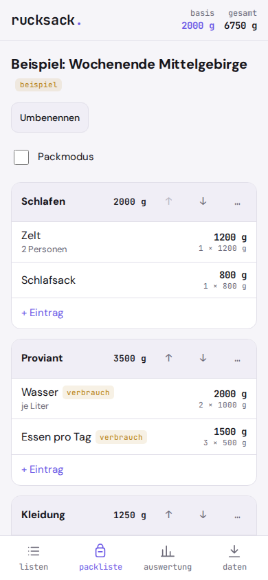
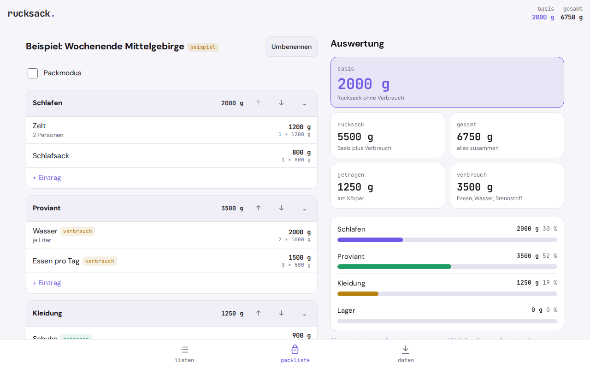

# rucksack.

**How heavy is your pack, really?** rucksack. is a packing list with gear weights for hiking, bikepacking and light travel. It works out base weight, worn weight and consumables for you, offline and without an account. It runs as an installable web app (PWA), and your lists never leave your phone.

   

The app interface is in German.

If you hike, go bikepacking or try to travel light, you plan your gear as a list with weights. The usual options are web services that need an account, or apps that cost money. Your list then sits on someone else's server, and out on the trail without signal you can't reach it. rucksack. does the core of that job as an installable web app: items with weights, categories, the split into base, worn and consumable weight, lists you can reuse, and backups as a file.

Plain arithmetic, no AI, no server. Everything stays on your phone.

<p align="center">
  
</p>
<p align="center">
  
</p>

## Why

Paid packing list apps focus on ticking items off, and weights are an afterthought. The well-known gear weight lists of the ultralight scene run as web services with an account and don't work offline. rucksack. is the counterpart without an account and without a server, with export and import as a file.

## Features

- **Multiple lists**: create, rename, delete (with confirmation) and duplicate, for example for your next trip
- **Categories** per list, named freely, sorted with up and down buttons
- **Items** with name, weight, quantity, type (`basis` base, `getragen` worn, `verbrauch` consumable) and a note. Weight in g, kg, oz or lb, always stored as whole grams
- **Live totals**: total, worn, consumables, pack weight and base weight, plus each category with its share in percent and a bar
- **Display unit** of your choice: g, kg, oz, lb
- **Packing mode**: only checkboxes and names, plus a button that clears all checks
- **Export** of all lists or the current list as a JSON file, import from JSON
- **Import of LighterPack CSV** as a new list, for moving over
- **Example list**, marked as `beispiel` ("example") and removable with one click
- Light and dark theme, works offline, installable as an app

Deliberately left out: accounts, sync, sharing by link, a gear database with manufacturer weights, prices, suggestions based on destination or weather, photos for items, CSV export in LighterPack format. The type applies to the whole item. If you wear one piece and carry the rest in the pack, create two items.

## Privacy

Nothing leaves your device. rucksack. has no server, no account, no analytics, no ads, and loads nothing from the network. Fonts and icons are bundled with the app. Your lists live in your browser's `localStorage`. Exports only happen when you trigger them yourself.

Because the data lives only in the browser: if you clear the site data, you also delete your lists. Some browsers clean up data on their own after a long time without use. So make a backup now and then. The app shows you the date of your last export.

## Install

rucksack. is a static web app. There is no build step and there are no dependencies.

1. Put the `rucksack/` folder on any static host (your own web space, GitHub Pages, Netlify, a Raspberry Pi). Installing it as an app requires HTTPS.
2. Open the address in your phone's browser.
3. In the browser menu choose **Add to Home Screen**. After that rucksack. starts like an app and also works without a connection.

Test locally:

```
cd rucksack
python3 -m http.server 8000
```

Then open `http://localhost:8000` in your browser.

## How the math works

The calculations are pure functions in `rechnen.js`, without DOM.

**Line.** Weight × quantity. Quantity 0 means: it's on the list, it doesn't come along this time, and it doesn't count.

**Totals.**
- total = sum of all lines
- worn = sum of lines with type `getragen`
- consumables = sum of lines with type `verbrauch`
- pack weight = total minus worn (what is on your back, consumables included)
- base weight = total minus worn minus consumables

**Categories.** Sum per category, share = sum ÷ total × 100, rounded to whole percent. If total = 0, the share is 0. The rounded shares don't have to add up to exactly 100, and the app doesn't hide that.

**Units.** 1 oz = 28.349523125 g, 1 lb = 453.59237 g. Input is rounded half up to whole grams. Display: g as whole numbers, kg with two, oz with one, lb with two decimal places, using a decimal comma.

**Example.** Tent 1200 g, sleeping bag 800 g (both `basis`), water 2 × 1000 g and food 3 × 500 g (both `verbrauch`), shoes 900 g and jacket 350 g (both `getragen`), chair 450 g with quantity 0:

- total 6750 g, worn 1250 g, consumables 3500 g
- pack weight 5500 g, base weight 2000 g
- Sleeping 30 %, Food 52 %, Clothing 19 %, Camp 0 % (101 % together, and that is correct)

**LighterPack CSV.** Columns are matched by the header row, not by position. Units `g`, `kg`, `oz`, `lb`. If `worn` or `consumable` is set, the type becomes `getragen` or `verbrauch`; if both are set, `verbrauch` wins. `url` and `price` are ignored, `desc` becomes the note. The format is not officially documented and may differ; the app reports errors if it does.

**Limits.** rucksack. only calculates with the weights you enter. Manufacturer figures are often optimistic, so weigh your gear yourself when in doubt.

The tests run without dependencies via `node --test` or `node test-calc.js` and check the hand calculations and test vectors.

## License

GNU Affero General Public License v3.0 (AGPL-3.0), see `LICENSE`.

**Deutsch:** rucksack. ist eine Packliste mit Gewichten für Wandern, Trekking und Bikepacking, die Basisgewicht, getragenes Gewicht und Verbrauch ausrechnet, offline als PWA und ohne Konto.

---

**gedacht.gemacht.** Small, honest software. Everything stays on your device. · [More projects](https://github.com/gedachtgemacht)
